

<picture><source media="(prefers-color-scheme: dark)" srcset="assets/hero-dark.svg"></picture>

<picture><source media="(prefers-color-scheme: dark)" srcset="assets/social-l-dark.svg"></picture><a href="https://t.me/kidknightik"><picture><source media="(prefers-color-scheme: dark)" srcset="assets/social-1-dark.svg"></picture></a><a href="https://twitch.tv/Kidknightik"><picture><source media="(prefers-color-scheme: dark)" srcset="assets/social-2-dark.svg"></picture></a><a href="https://www.tiktok.com/@kidknightik_"><picture><source media="(prefers-color-scheme: dark)" srcset="assets/social-3-dark.svg"></picture></a><a href="https://steamcommunity.com/id/Kidknightik/"><picture><source media="(prefers-color-scheme: dark)" srcset="assets/social-4-dark.svg"></picture></a><picture><source media="(prefers-color-scheme: dark)" srcset="assets/social-r-dark.svg"></picture>

<picture><source media="(prefers-color-scheme: dark)" srcset="assets/about-dark.svg"></picture>

<picture><source media="(prefers-color-scheme: dark)" srcset="assets/stack-dark.svg"></picture>

<a href="https://github.com/Kidknightik/fastzip"><picture><source media="(prefers-color-scheme: dark)" srcset="assets/project-fastzip-dark.svg"></picture></a>&nbsp;<a href="https://github.com/Kidknightik/win10-audio-overlay"><picture><source media="(prefers-color-scheme: dark)" srcset="assets/project-win10-audio-overlay-dark.svg"></picture></a>

<a href="https://github.com/Kidknightik/sftp_transfer"><picture><source media="(prefers-color-scheme: dark)" srcset="assets/project-sftp-transfer-dark.svg"></picture></a>&nbsp;<a href="https://github.com/Kidknightik/autotrash"><picture><source media="(prefers-color-scheme: dark)" srcset="assets/project-autotrash-dark.svg"></picture></a>

<picture><source media="(prefers-color-scheme: dark)" srcset="assets/stats-dark.svg"></picture>

<picture><source media="(prefers-color-scheme: dark)" srcset="assets/streak-dark.svg"></picture>

<picture><source media="(prefers-color-scheme: dark)" srcset="assets/wave-dark.svg"></picture>

<a href="https://github.com/Kidknightik?tab=repositories"><picture><source media="(prefers-color-scheme: dark)" srcset="assets/button-1-dark.svg"></picture></a>

<a href="https://metawka.github.io/expressive-profile/?from=Kidknightik"><picture><source media="(prefers-color-scheme: dark)" srcset="assets/credit-dark.svg"></picture></a>

